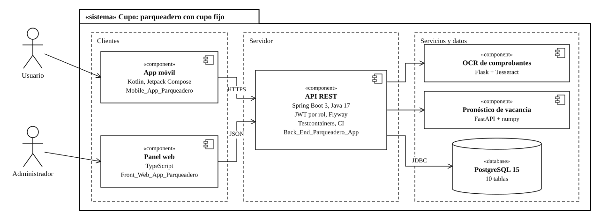

# Daniel Fernando Barragán Chía

Estudio Ingeniería de Software en la Universidad Manuela Beltrán. Trabajo sobre todo en backend con Java y Spring Boot, en apps Android con Kotlin y en análisis de datos con Python. Me interesan los sistemas donde los datos llegan a una decisión: un pago que se aprueba, una alerta de calidad del aire, un informe con cifras que se pueden verificar.

[LinkedIn](https://www.linkedin.com/in/daniel-chia-data)

## Proyectos destacados

### Cupo: sistema para un parqueadero con cupo fijo

Tres repositorios que forman un solo sistema para un parqueadero de 6 carros y 1 moto. Cada usuario paga su mensualidad con un comprobante que se lee con OCR y el administrador revisa. La puerta se abre cuando la cámara reconoce la placa de un usuario al día. El panel muestra ocupación, ingresos y mora, junto con un pronóstico de cupos libres que viene con su intervalo de incertidumbre.

| Repositorio | Qué es |
|---|---|
| [Back_End_Parqueadero_App](https://github.com/dannygetcode/Back_End_Parqueadero_App) | API REST en Spring Boot 3 con roles y JWT, esquema versionado con Flyway, pruebas de integración con Testcontainers y CI en GitHub Actions. Incluye el servicio de pronóstico en FastAPI y un simulador de 12 meses de datos. |
| [Mobile_App_Parqueadero](https://github.com/dannygetcode/Mobile_App_Parqueadero) | App Android en Kotlin y Jetpack Compose: activación con código, ingreso con PIN o huella, pagos, puerta y actividad del usuario. |
| [Front_Web_App_Parqueadero](https://github.com/dannygetcode/Front_Web_App_Parqueadero) | Panel del administrador en TypeScript: usuarios, revisión de pagos, puerta y analítica. |

### Motor de informes del CIUMB

[Motor_Estadistico_Capa_Analitica_CIUMB](https://github.com/dannygetcode/Motor_Estadistico_Capa_Analitica_CIUMB): práctica empresarial en el Centro de Investigaciones de la UMB. Un servicio en Python recibe una pregunta en lenguaje natural y la convierte en un informe exportable a PDF, DOCX, XLSX, HTML o CSV. La IA interpreta la pregunta y redacta el texto, pero nunca escribe SQL ni calcula una cifra: los números salen del motor estadístico (pandas, SciPy, statsmodels, scikit-learn), y un validador comprueba que cada número del texto coincida con lo calculado.

### Vigilancia de PM10 en Sogamoso y Nobsa

[Trabajo_de_Grado_Vigilancia_PM10_Sogamoso_Nobsa](https://github.com/dannygetcode/Trabajo_de_Grado_Vigilancia_PM10_Sogamoso_Nobsa): trabajo de grado. Es un sistema web que vigila el material particulado PM10 en el corredor industrial Sogamoso-Nobsa con los criterios de la Resolución 2254 de 2017. Valida las mediciones horarias, calcula promedios de 24 horas, propone los niveles de alerta, pronostica las siguientes 24 horas y publica una vista ciudadana. Lo componen siete servicios en tres contenedores, más un simulador que reproduce los datos del IDEAM con un reloj virtual.

### Mercado

[App_Mercado](https://github.com/dannygetcode/App_Mercado): app Android para llevar la cuenta del mercado contra un presupuesto. Escaneas el código de barras y el producto queda sumado. Funciona sin internet y guarda los datos en una base cifrada. Usa Kotlin, Jetpack Compose, Room con SQLCipher, CameraX y ML Kit.

### Simulador del crédito hipotecario

[simulador-hipotecario](https://github.com/dannygetcode/simulador-hipotecario): simulador web del modelo Logit de mi monografía en la UPTC sobre los determinantes del financiamiento de vivienda en Colombia (ECV del DANE, 2019 y 2024). Cambias las características de un hogar y una escena 3D muestra la probabilidad estimada de que tenga un crédito hipotecario.

## Con qué trabajo

| Área | Tecnologías |
|---|---|
| Backend | Java 17, Spring Boot 3, Spring Security con JWT, Spring Data JPA, Flyway |
| Datos y analítica | Python, pandas, NumPy, SciPy, statsmodels, scikit-learn, FastAPI, Flask |
| Móvil | Kotlin, Jetpack Compose, Material 3, Room, CameraX, ML Kit |
| Web | TypeScript, JavaScript, HTML y CSS |
| Bases de datos | PostgreSQL, SQL |
| Infraestructura y calidad | Docker Compose, GitHub Actions, Testcontainers, JUnit, pytest |
